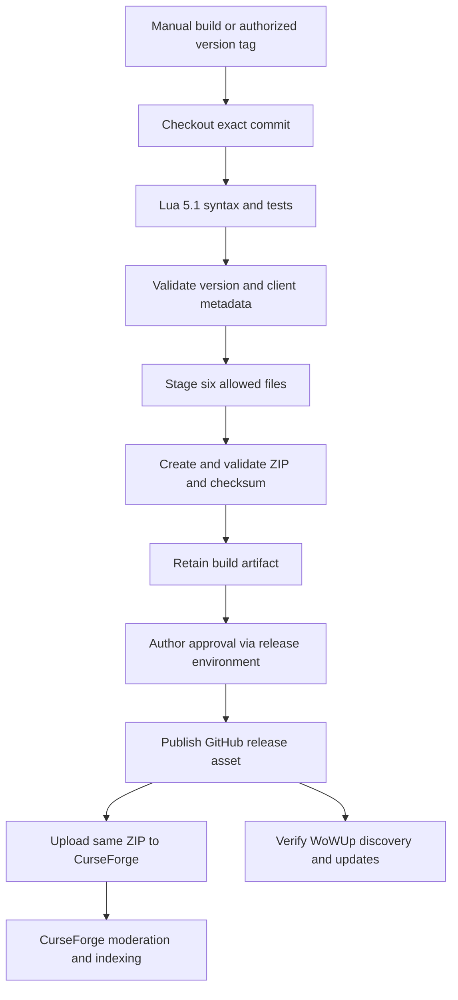

# Release process

## Goal

Publish one verified installable package to GitHub and CurseForge. Use the GitHub
release asset for WoWUp discovery and updates. Keep the AddOn runtime unchanged
by release automation.

Publishing is **off by default**. This document describes the process and the
setup it requires; it does not authorize a commit, tag, upload, or public release.



## Package contract

The filename follows the TOC version: `WeaponSkillsForever-<version>-forever.zip`.
The `-forever` suffix is one of the two ways WowUp 2.24.0 identifies a GitHub
asset for a Forever install (`/[-_](forever|camelot)\.zip$/i` in
`github-addon-provider.ts`); the other is the `release.json` asset described below.
The archive must contain exactly these files under one top-level folder:

```text
WeaponSkillsForever/
    WeaponSkillsForever.toc
    Commands.lua
    Skills.lua
    Core.lua
    UI.lua
    LICENSE
```

The validator permits one optional empty root directory entry. Additional files
or directories are not permitted. Exclude
`.tools/`, `.git/`, `.github/`, `tests/`, `docs/`, `artwork/`, README, TESTING,
agent guidance, generated logs, and all credentials/player data.

Use an explicit file allowlist. Do not ZIP the checkout and maintain a growing
list of exclusions. Keep `LICENSE` in the package, but do not load it in the TOC.
WSK ships no texture files: the skill box, bars, and setup panel use built-in
client textures only. The builder keeps its TGA validator, unused, in case a
texture is approved later.

Validate the actual archive, not only the staging folder:

1. Check CRC/integrity, non-empty files, and the exact file list.
2. Reject absolute paths, traversal paths, symlinks, and extra root folders.
3. Verify the TOC name, Interface `16001`, and Commands/Skills/Core/UI load
   order. Every listed runtime file must exist inside the archive.
4. Verify the packaged version matches the selected tag, with one leading `v`
   removed. Verify the packaged MIT copyright/permission notice is intact.
5. Check the packaged Lua files with Lua 5.1 syntax validation.
6. Produce a SHA-256 checksum outside the installable ZIP.

GitHub source archives and GitHub Actions artifact-download wrappers are not
installable release assets. Publish the verified inner ZIP as the release asset.
Build it once and reuse the same bytes for each destination.

## Local build and tests

The release helpers and their unit tests use Python 3's standard library only;
none are AddOn runtime dependencies. From the repository root:

```sh
python3 scripts/build_release.py --output dist
python3 -m unittest discover -s tests -p 'test_*.py'
```

On Windows, use the portable `.tools/python-3.13.7/python.exe` in place of
`python3` (see [TESTING.md](../TESTING.md) for tooling sources). The workflow
uses `ubuntu-24.04`, native `python3`, and apt-installed `lua5.1`; it cannot run
the local Windows `.tools/` binaries.

`scripts/build_release.py` uses the six-file allowlist, validates the
TOC/version/license and actual archive, and writes to `dist/`:

- `WeaponSkillsForever-<version>-forever.zip`;
- the adjacent `.zip.sha256` checksum;
- `release-manifest.json`;
- `release-notes.md`: the `CHANGELOG.md` section for the version, then the
  standing beta notes;
- `release.json`, BigWigs-format WowUp metadata naming the ZIP with flavor
  `forever` and Interface `16001`.

The GitHub release attaches the ZIP, checksum, manifest, and `release.json`.
WowUp 2.24.0 reads `release.json` first and maps its `forever` flavor to Forever
installs, falling back to the ZIP-name suffix. The publisher refuses to upload
unless `release.json` exactly names the verified ZIP.

Only the six package files are inside the installable ZIP. Checksums, manifest,
and notes stay outside it. Identical inputs and toolchain produce deterministic
ZIP bytes; this is not a cross-toolchain compression guarantee. The builder does
not itself run Lua syntax checks or establish client compatibility.

A local build requires no CurseForge credentials, tag, or GitHub CLI login.
Optional `--tag` must match the TOC version; do not invent a release tag.
Optional `--source-commit` accepts a real full lowercase 40-character Git SHA and
records `source_commit` in the external manifest. CI supplies `GITHUB_SHA`.
This is caller-supplied provenance, not a commit derived from ZIP contents or
proof that a local working tree equals that commit. Omit it when not established.

## CI and publication boundary

The workflow runs tests and builds on `main` pushes, pull requests, manual
dispatch, and `v*` tag pushes. Manual runs are build-only. Default permissions
are `contents: read`; build jobs receive no publisher secrets.
For tag builds, the Python builder validates the version against the TOC and
`git merge-base --is-ancestor HEAD origin/main` verifies source ancestry.
Publishers additionally require strict `vVERSION` tags matching the manifest.
A broad `v*` trigger alone is not version validation.

Checkout, artifact upload, and artifact download Actions are pinned to reviewed
full SHAs verified against the GitHub API. Review future pin changes, including
updates needed as GitHub deprecates Action runtimes.
CI checks Lua 5.1 syntax/logic and Python tests, builds once, syntax-checks the
packaged Lua, and retains `installable-addon` artifacts for 30 days.

The `github-release` job requires a tag push and repository variable
`ENABLE_GITHUB_RELEASES` exactly `true`. It uses the `release` environment,
`contents: write`, built-in `GITHUB_TOKEN`, and GitHub CLI `gh` on the hosted
runner. Local `gh` authentication is not needed for CI. It refuses an existing
release, creates a draft with the tested ZIP/checksum/manifest, revalidates, then
makes the release public. Beta versions are prereleases.

The `curseforge` job requires the GitHub publisher to succeed and **both**
`ENABLE_GITHUB_RELEASES` and `ENABLE_CURSEFORGE_UPLOADS` exactly `true`.
It also uses the `release` environment. Setting only the CurseForge flag cannot
publish. It requires positive decimal repository variables
`CURSEFORGE_PROJECT_ID` and `CURSEFORGE_GAME_VERSION_ID`, plus environment secret
`CF_API_TOKEN`. The uploader checks the server's selected game-version entry
for exact name `1.60.1` and Forever type `88568`; it never substitutes another
client/version. Redirects are refused and upload POSTs are never retried.
Only workflow attempt 1 may upload to CurseForge. A successful upload receipt
(`curseforge-upload.json`) is retained for 90 days; acceptance is not moderation
approval. Receipts are not distributed locks or proof that an unacknowledged
request failed.

`scripts/verify_release.py` revalidates the ZIP, manifest, checksum sidecar,
source commit against the workflow SHA, and the current remote tag. It handles
lightweight tags and peels annotated tags to a commit. The workflow invokes it
**before GitHub draft creation, again before public publication, and before
CurseForge upload**. Provenance and tag checks are separate from ZIP validation.
They are not atomic with publication: a tag can still move between a check and
an external operation. Immutable-tag protection is required, not optional proof
provided by these rechecks.

## Required setup before enabling publication

1. **Leave both opt-ins disabled.** In repository **Settings → Secrets and
   variables → Actions → Variables**, leave `ENABLE_GITHUB_RELEASES` and
   `ENABLE_CURSEFORGE_UPLOADS` absent or set them to `false` while preparing.
2. **Configure approvals first.** In **Settings → Environments**, create/select
   `release`, configure required reviewers under deployment protection rules,
   and prevent self-review/bypass where supported. Limit deployment tags to the
   intended release-tag pattern. Verify required reviewers are available for
   this repository/plan and that a job actually waits for approval before any
   publishing step. Merely declaring `environment: release` does **not** create
   required reviewers. If enforced approvals are unavailable, leave flags off
   until an agreed effective gate exists. Before enabling the publisher, run
   the no-upload `gate-check.yml` workflow from `main`
   (`gh workflow run gate-check.yml --ref main`) and confirm its job waits for
   approval; ordinary build-only runs do not exercise the environment gate.
   It needs `main` in the environment's deployment branch rules.
3. **Protect tags and source.** In **Settings → Rules → Rulesets**, create an
   active tag ruleset targeting `v*`: restrict creation to authorized maintainers
   and restrict updates and deletions. Minimize bypass permissions; never move
   or delete a released tag. Protect `main` through the repository's agreed
   review controls. Confirm rules actually apply before publication; ancestry
   and repeated API checks cannot eliminate a tag-movement race.
4. **Finish service setup.** Create/verify the CurseForge project and exact
   Forever `1.60.1` game-version ID/type `88568`. Project form text is in
   [CURSEFORGE_LISTING.md](CURSEFORGE_LISTING.md). Create the upload token at
   https://authors.curseforge.com/#/settings/api-tokens, then find the version
   ID locally with `python3 scripts/curseforge_versions.py`; it reads the token
   from `CF_API_TOKEN` or a hidden prompt, sends one read-only GET, and marks
   the `1.60.1` entry. In repository Actions variables,
   set `CURSEFORGE_PROJECT_ID` and `CURSEFORGE_GAME_VERSION_ID` to the verified
   positive decimal IDs, not example values. In **Settings → Environments →
   release → Environment secrets**, add author upload token `CF_API_TOKEN`.
   Never put it in source, chat, a URL, or build-job configuration. GitHub
   publishing needs no separate personal token: `GITHUB_TOKEN` is built in.
5. **Verify the candidate.** Run the build-only workflow, inspect its inner ZIP
   and checksum/manifest, install that exact ZIP in a clean client folder, and
   complete the client checklist in [TESTING.md](../TESTING.md). Record actual
   test results; expected totals are not passing evidence. Confirm public GitHub
   access and current CurseForge/WoWUp Forever and beta-channel support.
6. **Enable only intended destinations after gate verification.** Set repository
   variable `ENABLE_GITHUB_RELEASES` to literal `true` when approved. Set
   `ENABLE_CURSEFORGE_UPLOADS` to literal `true` only after its service setup is
   complete and GitHub publication is also enabled. Leave it false for a
   GitHub-only release. Neither a manual run nor a `main` push publishes.
7. **Publish an authorized immutable tag.** The tag must be exactly `v` plus the
   TOC version and point to the reviewed commit on `main` (or an ancestor).
   Push it only with authorization. Approve the environment jobs, inspect the
   public GitHub assets, then the CurseForge receipt/moderation state. Check
   WoWUp discovery rather than treating upload success as a client update.

Do not use a blind workflow rerun as a recovery procedure. See
[failures and retries](#failures-and-retries) below.

## Release checklist

### Client and package

- [ ] Record the client version, build, and Interface you tested on. If the
      Interface changed, update the TOC; if the version changed, find the new
      CurseForge game-version ID with `scripts/curseforge_versions.py`.
- [ ] Test the panels, Save/Enter/Cancel/Escape, and layout at the supported UI
      scales.
- [ ] Verify the skill box, bar colors, setup panel, and saved settings in
      client, including after `/reload` and on a second character.
- [ ] Complete the safety checks in [TESTING.md](../TESTING.md).
- [ ] Run the Lua 5.1 tests, syntax checks, Python release-helper tests, and
      actionlint for the release commit; record actual results.
- [ ] Install from the exact release ZIP into a clean AddOn folder and test it.
- [ ] Record the release commit, client build, test results, and ZIP hash.

### Project pages

- [ ] Create or update the CurseForge project, with MIT and the usage description.
- [ ] Confirm Forever `1.60.1` is available in the current file-version choices
      and API. Record the exact version ID and its Forever game-version type.
      Do not substitute Retail, Classic, a nearby version, or an untested build.
- [ ] Add a project logo, the repository link, and the issue-tracker link.
- [ ] Choose the CurseForge main category and use the same text for the TOC
      `## Category`; the in-game AddOn list groups by that exact text when
      Dyre's Toolkit is missing (`## Group: DyresToolkit` nests WSK under it).
- [ ] Capture the skill box and the setup panel. Crop unrelated chat and player
      information.
- [ ] Set a GitHub social-preview image. WoWUp's Hub guide uses that image, with
      the author avatar as a fallback.
- [ ] Confirm the GitHub repository and release asset are publicly accessible
      for WoWUp.

### Release notes

Every release note must state beta-only compatibility and the tested build.
Do not claim support beyond the tested build, even if a site lists a broader
version label.

### Later releases

1. Update code and the TOC version, and add a `## <version>` section to
   `CHANGELOG.md` listing the player-facing changes; run the checks above.
   The builder puts that section at the top of `release-notes.md`, which
   becomes both the GitHub release notes and the CurseForge changelog, and it
   fails the build if the section is missing or empty.
2. Review and commit the change.
3. Push the authorized version tag.
4. Let CI test, package, validate, and publish to the enabled destinations.
5. Check each upload and manager-facing result. Keep moderation and client update
   behavior separate from CI success.

## What automation can and cannot do

| Destination | Automated path | Limits |
| --- | --- | --- |
| GitHub | Create a release and attach the tested ZIP through Actions. | Publication needs repository permission and an approved version tag. |
| CurseForge | Upload a new file, changelog, release type, and supported game-version IDs through its Upload API. | The project must exist. Uploads can require moderation; acceptance is not immediate publication. |
| WowUp | Make the installable `-forever.zip` and `release.json` available as public GitHub release assets. | WowUp 2.24.0 or later is required for Forever. Users install by repository URL; when a repo has only prereleases, WowUp uses them. Topics and the social preview image control browse listings. Verify discovery and update detection in the app. No separate WowUp upload token is established by its Hub guide. |
| Other sites | Add a publisher only when its Forever support and API have been verified. | Do not assume that packager support means every service supports the target client. |

An upload or new GitHub release makes an update available. It does not force an
update on players' computers. Discovery, caching, selected release channels,
moderation, and the user's manager settings control when an update appears.
Do not add a self-updater to the AddOn.

## Failures and retries

- A new approved CurseForge file updates that project's available versions.
- A public GitHub release asset gives WoWUp's GitHub provider an update source.
  Its Hub guide does not specify a guaranteed indexing time or a universal
  refresh webhook. Verify repository discovery, Forever detection, and beta
  subscription in the actual app. Do not invent a notification API.
- The game must not be modified while running merely because CI published a ZIP.
  Installation is the manager/user's responsibility.
- GitHub publication and a CurseForge upload are not one atomic operation. Report
  each destination separately and retain the tested artifact if one fails.
- Record tag, commit, ZIP hash, GitHub release/asset identifiers, CurseForge file
  ID, and moderation status. Use those records before retrying a failed run.
- Do not blindly repeat a timed-out upload. It may have created a file even when
  the client received no response. Check for an existing matching file first.
  Preserve the original build artifact, logs, hash, manifest, and any receipt.
- If GitHub failed after draft creation, inspect that draft and its uploaded
  assets and reverify the immutable tag/commit before any authorized manual
  completion. The job refuses an existing release; rerunning it is not a
  draft-recovery or replacement mechanism.
- If GitHub succeeded but CurseForge failed or timed out, retain the GitHub
  release and inspect the CurseForge dashboard and receipt for acceptance and
  moderation. The workflow blocks CurseForge on attempts greater than 1; do not
  bypass that guard or create another run merely to repeat an uncertain POST.
  Only consider an explicitly reviewed destination-specific recovery after
  establishing that no file was accepted and rechecking provenance/version.
- If a tag/provenance check fails, stop. Do not move the tag or replace assets
  to force a match. Review the cause; use a new version/tag for corrected code.
- To halt future publishing while investigating, set the relevant repository
  opt-in(s) to `false`. This does not roll back an accepted upload or guarantee
  that an already-running publisher stops; inspect remote state.
- Do not delete approved files or move a published tag to fix an error. Correct
  the source and publish a new version, or use a deliberately reviewed retry for
  a destination that never received the original file.

## Design decisions

### Triggers and release channels

- Run read-only tests on ordinary pushes and pull requests. Never publish from
  a pull-request run, fork, or arbitrary branch push.
- Manual runs are build-only and upload nothing.
- Version-tag pushes are the release trigger. A tag such as `v0.1.0-beta` must
  match TOC version `0.1.0-beta`. Validate the tag rather than trusting a broad
  `v*` trigger, and treat manual inputs as data, not shell source.
- Mark beta tags as GitHub prereleases and CurseForge `beta` files. Do not mark
  them stable merely to make them appear in a manager's default channel.
- GitHub and CurseForge have separate release-channel rules. The CurseForge
  submission guide warns that beta-only projects may not sync normally to its
  app and that a Release file is needed for normal project syncing. Verify the
  actual behavior before promising discovery.
- Use one publication workflow with explicit jobs. A release created with
  `GITHUB_TOKEN` does not normally trigger a second `release` workflow, so do not
  rely on that chained event to perform the CurseForge upload.
- Avoid using both tag-push and release-published triggers for the same upload;
  otherwise one version can be published twice.

### Permissions, approvals, and secrets

- Test/build jobs get only `contents: read` and no publisher secrets.
- The GitHub publication job gets `contents: write` and uses the workflow's
  `GITHUB_TOKEN`; a personal token is not needed for that repository's release.
- The CurseForge Upload API token is a GitHub secret named `CF_API_TOKEN`. It is
  an author upload token, not a catalog API key. Send it in the `X-Api-Token`
  header, never in a URL or source file.
- The project ID and validated game-version ID are non-secret configuration.
- Gate publication with an approved release environment where the repository's
  GitHub plan permits it. Declaring an environment alone does not configure
  required reviewers.
- Pin Actions to reviewed full commit SHAs. Review scripts called by those
  Actions as well as their top-level YAML. Do not use mutable branches as pins.
- Restrict tag creation/publication to maintainers. Serialize publication per
  version; do not cancel a publisher midway through an upload.
- Never expose publication secrets to untrusted pull-request code.
- GitHub-hosted runners and external upload APIs involve network access. Check
  Actions quotas/billing and service rate limits before enabling repeated runs.

### Custom builder rather than BigWigs packager

This AddOn has only six distribution files, so the project uses a small
allowlist ZIP builder plus separate publication jobs: a Linux runner obtains
Lua 5.1, runs the suite, builds the archive, retains it as an artifact, and
publishes the tested bytes through GitHub CLI and the documented CurseForge
Upload API after approval. CurseForge's Upload API accepts multipart `metadata`
and `file` fields; metadata includes `gameVersions`, `releaseType`, and
`changelog`/`changelogType`. Record the returned file ID and distinguish
successful upload from moderator approval.

BigWigsMods/packager was evaluated as an alternative (reviewed upstream commit
`0f24d2169de3ceb3b79a981311b2ebab4c6160c7`). It supports Forever, Interface
`16xxx`, version-tag channels, GitHub releases, CurseForge uploads, and a
`release.json` asset with client metadata. Adopting it would require controls
for this project:

- `.pkgmeta` can set `package-as: WeaponSkillsForever` and exclude development
  material. Exclusions alone are not our package allowlist; validate the ZIP.
- Its default changelog generation creates `CHANGELOG.md` inside the package,
  violating the six-file contract, unless configured otherwise.
- Its CurseForge uploader can fall back to another game version when an exact
  match is absent. The workflow must fail before publishing if Forever `1.60.1`
  is unavailable; a warning and a nearby version are not acceptable.
- Package in no-upload mode (`-d`) before examining artifacts. Do not provide
  upload secrets to a combined packaging step that can publish before validation.
- A later upload must consume the already verified archive, not a silent rebuild.
- The composite Action reads `CF_API_TOKEN` for CurseForge and `GH_API_TOKEN` for
  GitHub. Map `GH_API_TOKEN` to the job's `GITHUB_TOKEN`, not a broad personal token.
- The reviewed upstream uploader does not support Forever uploads to
  WoWInterface. Do not enable that destination based only on the tool's name.

Reconfirm this behavior if the packager is reconsidered.

## References

- [Project overview and usage](../README.md)
- [Verification method and client checklist](../TESTING.md)
- [CurseForge submission guide](https://support.curseforge.com/en/support/solutions/articles/9000197241-project-submission-guide)
- [CurseForge Upload API](https://support.curseforge.com/en/support/solutions/articles/9000197321-curseforge-upload-api)
- [WoWUp Hub guidance](https://wowup.io/guide/wowup/hub)
- [GitHub workflow triggers and token event behavior](https://docs.github.com/en/actions/how-tos/write-workflows/choose-when-workflows-run/trigger-a-workflow)
- [Reviewed BigWigs Action](https://github.com/BigWigsMods/packager/blob/0f24d2169de3ceb3b79a981311b2ebab4c6160c7/action.yml)
- [Reviewed BigWigs release script](https://github.com/BigWigsMods/packager/blob/0f24d2169de3ceb3b79a981311b2ebab4c6160c7/release.sh)
- [Reviewed BigWigs setup script](https://github.com/BigWigsMods/packager/blob/0f24d2169de3ceb3b79a981311b2ebab4c6160c7/setup-packager.sh)
